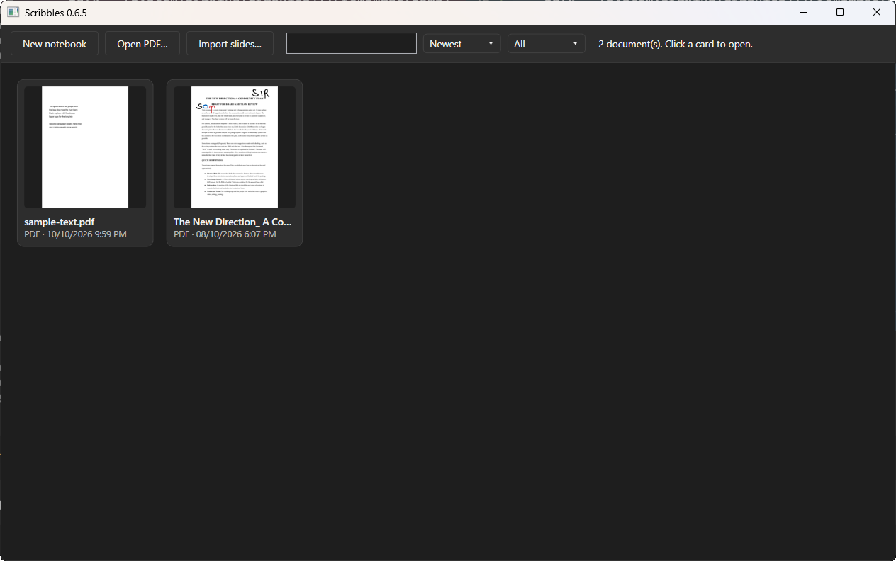
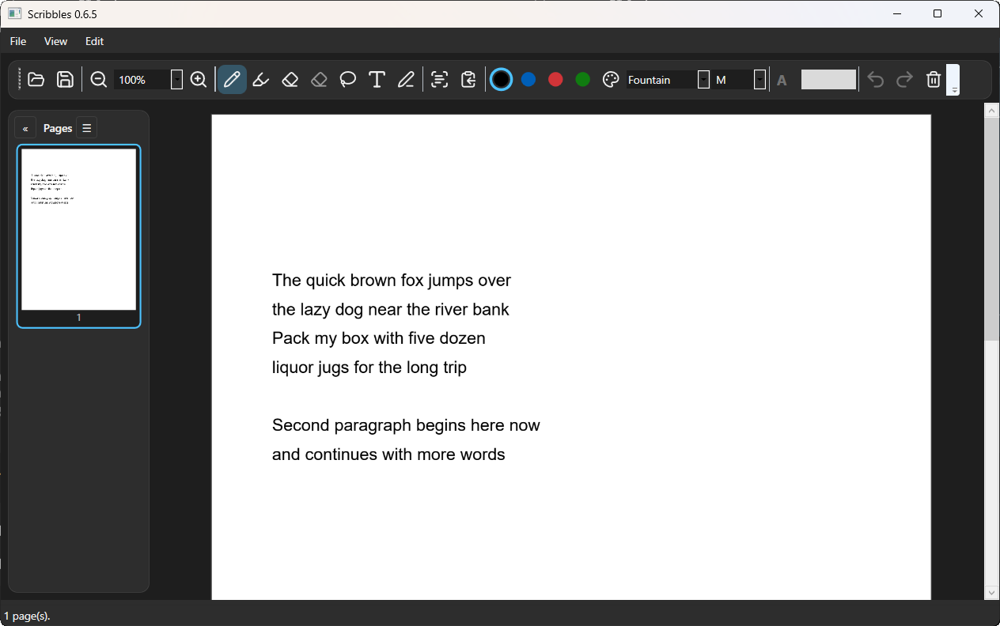

# Scribbles

Scribbles is an annotator for Windows PCs, laptops and tablets, in the spirit of Samsung Notes. You write on PDFs, slides and blank notebooks with a pen, mouse or touch. Afterwards you decide what happens to your handwriting: it can stay as ink, it can become editable text, or it can stay visible as ink while silently becoming copyable in the exported PDF.

The app is built natively in C# and WPF, so pen latency stays low and handwriting recognition works offline through Windows itself. Every dependency is free and open source.

## Download

Download `Scribbles-win-Setup.exe` from the [Releases page](https://github.com/SummaDiaboli/Scribbles/releases). Installation is per user, so it never asks for admin rights. After installing, the app updates itself in the background, and it asks you to restart only when an update is fully downloaded and ready.

You need Windows 10 (build 19041) or newer. A mouse is enough to use everything. A pen adds pressure-sensitive ink, and a touchscreen adds finger scrolling and pinch-zoom. If the .NET 8 Desktop Runtime is missing, the installer fetches it for you.




## Features

**Inking**
- The pen draws while fingers scroll and pinch-zoom, and palm rejection keeps a resting hand from marking the page.
- There are three pen families: Ballpoint draws a fixed width, Fountain responds to pen pressure, and the Highlighter is translucent with a flat nib.
- Five thicknesses run from extra fine to extra bold (1 to 8 pt), and you can type any custom size from 1 to 20 pt.
- The eraser, lasso select (move, resize, recolor, delete) and per-page undo/redo cover corrections.
- The color picker has an HSV field, a hue rail and hex input, plus a saved palette of your own colors.
- The toolbar can be dragged between the top and the bottom of the window.
- Double-clicking a word selects it.

**Handwriting recognition**
1. **Keep as ink** (the default): your writing stays exactly as you wrote it.
2. **Convert to text**: the ink is replaced with an editable text box sized to match what you wrote.
3. **Keep ink and make it copyable**: the ink stays visible, and an invisible text layer goes underneath it. This is the same trick searchable scanned PDFs use, so selecting the handwriting in any PDF viewer copies real text.

Recognition uses the handwriting recognizer built into Windows. It works offline with whatever handwriting language packs are installed.

**Reading and navigation**
- Find in document (`Ctrl+F`) searches every page with a live match count, steps forward and back through the hits, and highlights each one.
- The bookmark outline panel lists a long document's chapters so you can jump straight to them.
- Native PDF text selects and copies the way it does in a browser, and the TextEdit tool lets you click a line and retype it in place.

**Documents**
- The PDF itself is the save file. Ink is stored as standard `/Ink` annotations, so it shows up in Edge and Acrobat, and the full note model travels inside the PDF, so reopening a saved file keeps every stroke editable.
- A PDF changed by another tool still opens, and its ink annotations come back as editable strokes. Even a PDF too broken to save into still opens, with your ink kept in a small sidecar file next to it.
- **Export flattened copy** burns everything into a shareable file.
- Blank notebooks grow page by page whenever you need more room.
- Slides come in through PowerPoint when it is installed, or through LibreOffice headless otherwise.
- Autosave keeps working copies in the background, and File → Recover autosave lists every snapshot after a crash.

**Shell**
- The home grid shows thumbnails of notebooks and recent files, with search, sorting and a kind filter. Cards can be opened, renamed or sent to the Recycle Bin.
- The page sidebar shows live ink thumbnails with a hover magnifier, and the current page stays highlighted as you scroll.
- Right-click any PDF in Explorer to open it here. Scribbles only joins the Open With menu and never takes over the default.
- The theme follows the system, or you can pin light or dark.
- Settings cover the theme, default pen, autosave interval, export defaults and the update channel (stable or beta), and the window size and position are remembered too.

## Building from source

To build the app yourself you need the [.NET 8 SDK](https://dotnet.microsoft.com/download/dotnet/8.0). A Windows handwriting language pack enables recognition, and PowerPoint or LibreOffice enables slide import. Both are optional.

```powershell
git clone https://github.com/SummaDiaboli/Scribbles.git
cd Scribbles
dotnet run --project Scribbles.App
```

The app opens at the home grid. You can also pass a PDF path as an argument to open it directly.

To build a release:

```powershell
dotnet publish Scribbles.App/Scribbles.App.csproj -c Release
```

Official releases are cut by pushing a `v*` tag. Then CI tests the code, publishes it, packs it with Velopack and uploads the installer, the portable build and the update packages to the Releases page.

## Keyboard and input

| Action | Input |
| --- | --- |
| Draw | Pen |
| Scroll / zoom | One finger / two-finger pinch, or `Ctrl` + mouse wheel |
| Open / save | `Ctrl+O` / `Ctrl+S` |
| Find in document | `Ctrl+F` (`Enter` next, `Shift+Enter` previous) |
| Undo / redo | `Ctrl+Z` / `Ctrl+Y` |
| Delete selection | `Del` |
| Copy selected text | `Ctrl+C` |

## Project layout

```
Scribbles.Core/     Pure logic: note model, serialization, coordinate transforms,
                    stroke ops, undo/redo, settings, export planning
Scribbles.Pdf/      PDF read/write: /Ink annotations, PieceInfo store, text
                    extraction, flattened export
Scribbles.App/      WPF shell: home grid, page viewer, pen toolbar, dialogs,
                    themes, recognition, rendering and auto-update services
tests/
  Scribbles.Unit.Tests/         Fast tests on Core (incl. FsCheck property tests)
  Scribbles.Integration.Tests/  Real PDF round-trips, export, golden images
  Scribbles.E2E.Tests/          Headless + FlaUI tests driving the real app
  fixtures/                     Sample PDFs and golden images
```

## Testing

```powershell
dotnet test tests/Scribbles.Unit.Tests
dotnet test tests/Scribbles.Integration.Tests
dotnet test tests/Scribbles.E2E.Tests
```

CI (GitHub Actions on `windows-latest`) runs unit and integration tests on every push, and it fails the build when line coverage on `Scribbles.Core` drops below **90%**. E2E tests also run on PRs to `main` and on `v*` tags.

Interactive E2E tests (real mouse and keyboard) only run when `SCRIBBLES_INTERACTIVE_E2E=1` is set. Do not set it on your dev machine, because those tests take over the desktop.

## Built with

- [WPF](https://github.com/dotnet/wpf) on .NET 8 with [CommunityToolkit.Mvvm](https://github.com/CommunityToolkit/dotnet)
- [Docnet.Core](https://github.com/GowenGit/docnet) (PDFium) for page rendering
- [PDFsharp](https://github.com/empira/PDFsharp) for writing PDFs
- [PdfPig](https://github.com/UglyToad/PdfPig) for text extraction, page sizes and outlines
- [Velopack](https://github.com/velopack/velopack) for the installer and auto-updates
- xUnit, Shouldly, FsCheck, Verify, coverlet and [FlaUI](https://github.com/FlaUI/FlaUI) for tests

## Roadmap

- A code-signed installer (releases are currently unsigned, so SmartScreen warns on first install)
- Beta update channel builds alongside stable
- A Microsoft Store listing as an alternative to Velopack distribution
